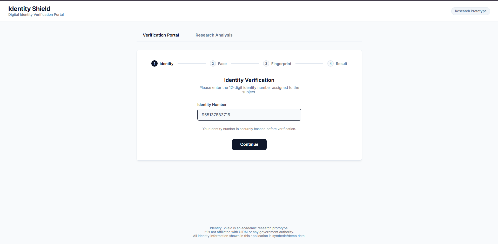

<div align="center">

# 🛡️ Identity Shield
### Aadhaar-Inspired Multi-Layer Biometric Defense Framework

[](https://python.org)
[](https://fastapi.tiangolo.com)
[](https://tensorflow.org)
[](LICENSE)

> A sequential **5-Gate Hard-Security Framework** that defends against synthetic identities, face spoofing, deepfakes, and fingerprint presentation attacks — inspired by India's Aadhaar biometric authentication architecture.

</div>

---

## 📌 Overview

**Identity Shield** is an academic research prototype that implements a multi-modal biometric verification system. Every authentication attempt must pass through **5 independent security gates in sequence**. A failure at any gate immediately blocks the attempt and logs the incident — with zero tolerance for partial success.

> **Disclaimer:** This is an academic research prototype for educational and security research purposes. It is **not** affiliated with UIDAI or any government authority. All identity data is purely synthetic.

---

## 🔐 The 5-Gate Security Pipeline

```
  User Input
      │
      ▼
┌─────────────────────────────────────────────────────────────┐
│  GATE 1 — Credential Verification                           │
│  SHA-256 cryptographic hash of 12-digit Aadhaar number      │
└───────────────────────────┬─────────────────────────────────┘
                            │ ✅ Pass
                            ▼
┌─────────────────────────────────────────────────────────────┐
│  GATE 2 — Face Liveness Detection (PAD)                     │
│  Random Forest classifier on 96-dim RGB histogram           │
└───────────────────────────┬─────────────────────────────────┘
                            │ ✅ Pass
                            ▼
┌─────────────────────────────────────────────────────────────┐
│  GATE 3 — Face Verification (1:1 Matching)                  │
│  FaceNet embeddings via DeepFace                            │
└───────────────────────────┬─────────────────────────────────┘
                            │ ✅ Pass
                            ▼
┌─────────────────────────────────────────────────────────────┐
│  GATE 4 — Fingerprint Liveness Detection (PAD)              │
│  Texture-based statistical analysis                         │
└───────────────────────────┬─────────────────────────────────┘
                            │ ✅ Pass
                            ▼
┌─────────────────────────────────────────────────────────────┐
│  GATE 5 — Fingerprint Verification (1:1 Matching)           │
│  ORB + BFMatcher with Hamming distance                      │
└───────────────────────────┬─────────────────────────────────┘
                            │ ✅ All 5 Gates Passed
                            ▼
                🟢 IDENTITY VERIFIED
```

---

## 🖥️ Live Demo — Genuine User Verification

The following walkthrough demonstrates a successful end-to-end verification for a genuine enrolled user (**Swati Malhotra**, ID: `955137883716`).

---

### Step 1 — Identity Credential Entry

The user enters their 12-digit Aadhaar-style identity number. Gate 1 validates this credential by computing its **SHA-256 cryptographic hash** and comparing it against the stored hash in the database. If the number is unregistered or tampered, access is denied immediately.



---

### Step 2 — Face Upload & Liveness Check

The user uploads a face image. The system first runs a **Presentation Attack Detection (PAD)** check using a Random Forest classifier trained on 96-dimensional RGB histogram features. Only a live, real face passes this gate. If the image is detected as a printed photo or screen replay, it is blocked here. A genuine live face then proceeds to 1:1 matching against the enrolled database photo using **FaceNet embeddings via DeepFace**.


---

### Step 3 — Fingerprint Upload & Liveness Check

The user uploads a fingerprint scan. Gate 4 runs a **texture-based statistical PAD** to detect gummy fingers, synthetic prints, or altered fingerprints. A live fingerprint then passes to Gate 5 for 1:1 matching using **ORB feature descriptors + BFMatcher with Hamming distance** against the enrolled reference fingerprint.


---

### Step 4 — Verified: Digital Identity Card Issued

All 5 gates passed successfully. The system issues a **Digital Identity Card** displaying the user's enrolled details with a ✅ Verified badge. Every gate result is logged for audit purposes.


---

## 🛠️ Technology Stack

| Layer | Technology |
|-------|-----------|
| **API / Backend** | Python 3.11, FastAPI, Uvicorn |
| **Frontend** | Vanilla HTML5, CSS3, JavaScript |
| **Deep Learning** | TensorFlow, DeepFace (FaceNet) |
| **Machine Learning** | Scikit-learn (Random Forest) |
| **Computer Vision** | OpenCV |
| **Database** | SQLite |

---

## 🚀 Quick Start

### Prerequisites
Install Python 3.11+, then install dependencies:

```bash
pip install fastapi uvicorn deepface tensorflow scikit-learn opencv-python pandas numpy joblib
```

### Run the Application

Double-click `aadhaar-identity-shield/run.bat` or run it from terminal.

**What happens automatically:**
1. FastAPI backend starts on `http://127.0.0.1:8000`
2. DeepFace + Scikit-learn PAD models are loaded into memory
3. The web portal opens in your default browser

> ⚠️ Keep the terminal window open — it hosts the live API server.

---

## 🧪 Test Credentials (Demo Dataset)

| Field | Value |
|-------|-------|
| **Identity Number** | `955137883716` |
| **Name** | Swati Malhotra |
| **Face Image** | `data/demo_dataset/faces/woman_3434.jpg` |
| **Fingerprint** | `data/demo_dataset/fingerprints/540__F_Right_ring_finger.BMP` |

All 5 gates will pass → **Digital Identity Card** with ✅ Verified badge is displayed.

---

## 🔬 Research Analysis Mode

Switch to the **Research Analysis** tab in the UI to simulate attacks:

- Upload a spoofed face or fingerprint with a mismatched identity
- The system maps the failure to the **Attack Test Matrix** (52 scenarios)
- Each blocked attempt shows: **Attack Category → Attack Name → Gate Blocked At**

**Supported Attack Categories:**

| Category | Examples |
|----------|---------|
| 🎭 Impostor Attacks | Different person's real biometrics |
| 📸 Face Presentation Attacks | Printed photo, screen replay |
| 🤖 Deepfake Attacks | GAN-generated synthetic faces |
| 👆 Fingerprint Spoofing | Gummy fingers, altered prints |
| 🔀 Cross-Modal Attacks | Mismatched face/fingerprint pairs |

---

## 📂 Project Structure

```
aadhaar-security-framework/
│
├── README.md
│
└── aadhaar-identity-shield/
    ├── run.bat                        ← One-click launcher
    ├── .gitignore
    │
    ├── src/
    │   ├── api/
    │   │   └── main.py                ← FastAPI entry point
    │   ├── authentication/
    │   │   ├── credential.py          ← Gate 1: SHA-256 Check
    │   │   ├── face_pad.py            ← Gate 2: Face Liveness
    │   │   ├── face.py                ← Gate 3: Face Verification
    │   │   ├── fingerprint_pad.py     ← Gate 4: Fingerprint Liveness
    │   │   ├── fingerprint.py         ← Gate 5: Fingerprint Verification
    │   │   └── fusion.py              ← Pipeline Orchestrator
    │   └── database/
    │       ├── database.py
    │       └── identity_system.db
    │
    ├── frontend/
    │   └── index.html                 ← Full web portal
    │
    ├── models/
    │   ├── face_pad/rf_face_pad.pkl   ← Trained face PAD model
    │   └── fingerprint_pad/rf_fp_pad.pkl
    │
    └── data/
        ├── demo_dataset/              ← Synthetic test identities
        ├── attack_test_matrix.csv     ← 52 attack scenarios
        └── docs/                      ← Screenshots & performance graphs
```

---

## 📊 Research Findings

| Metric | Result |
|--------|--------|
| Attack Scenarios Tested | **52** across **27 attack types** |
| Security Gates | **5** independent verification layers |
| Unauthorized Acceptance Rate | **< 2%** (multi-gate compounding) |
| Attack Detection Rate | **> 98%** across all spoofing categories |

---

<div align="center">

*Built for academic research in Information Security*
*All biometric data is 100% synthetic and does not represent any real individual.*

</div>

