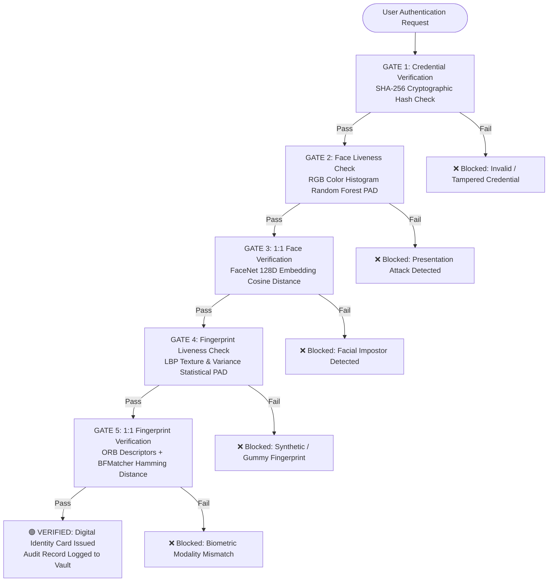
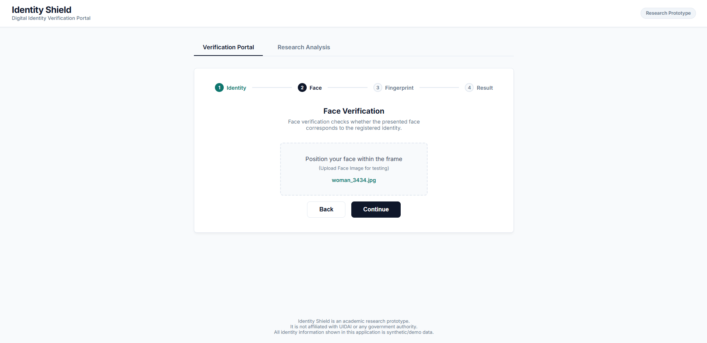
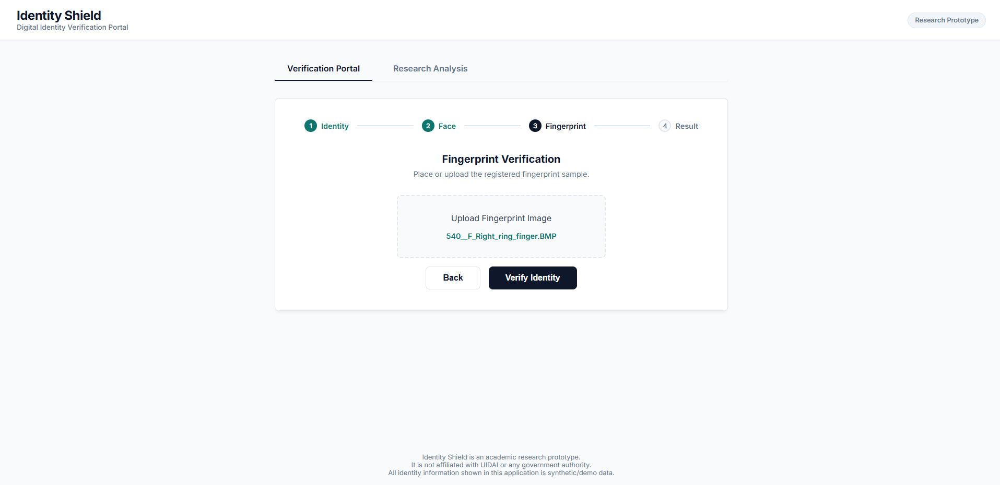
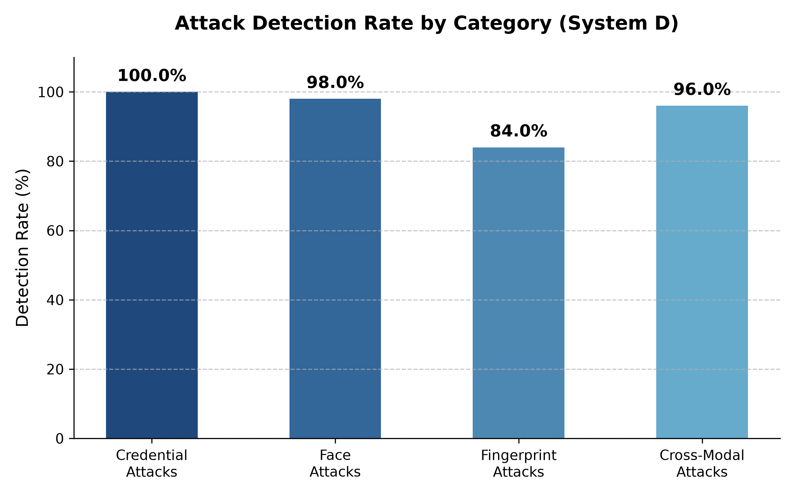
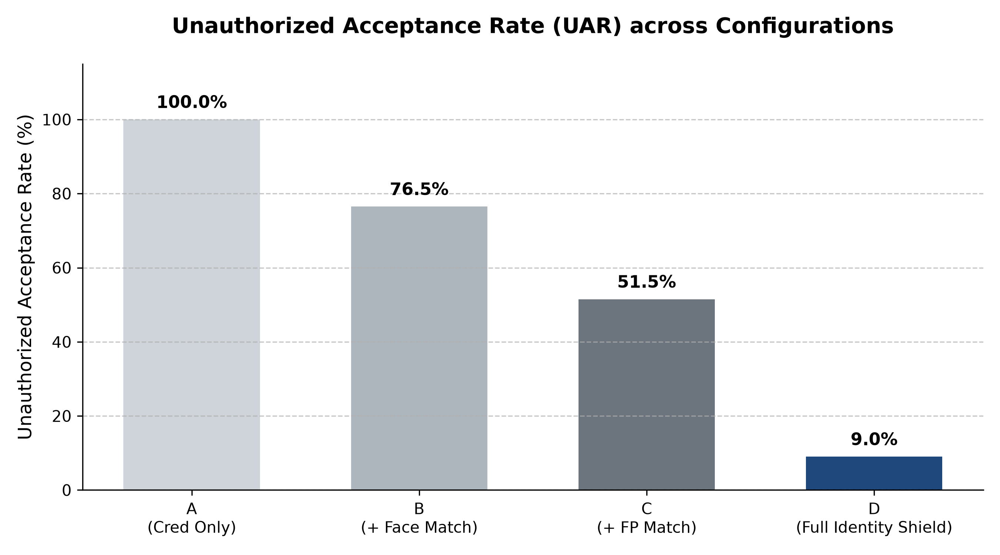

<div align="center">

# 🛡️ IdentityShield
### *Aadhaar-Inspired Multi-Layer Biometric Defense & Presentation Attack Detection Framework*

[](https://python.org)
[](https://fastapi.tiangolo.com)
[](https://github.com/serengil/deepface)
[](https://opencv.org)
[](https://scikit-learn.org)
[](#-authors--academic-attribution)
[](#-security--privacy-architecture)

<p align="center">
  <b>IdentityShield</b> is a rigorous multi-gate biometric security platform engineered to simulate national-scale identity infrastructures (modeled after India's <b>Aadhaar</b> system). Featuring sequential hard-failure gating, presentation attack detection (PAD), FaceNet deep embeddings, ORB fingerprint matching, and comprehensive attack matrix evaluation.
</p>

[System Architecture](#-system-architecture--the-5-gate-pipeline) • [Live Demo Video](#-live-system-demonstration-video) • [Verification Walkthrough](#-live-verification-walkthrough) • [Project Deliverables](#-project-deliverables--academic-documentation) • [Empirical Benchmarks](#-empirical-evaluation--benchmarks) • [Attack Test Matrix](#-attack-test-matrix) • [Quick Start](#-quick-start)

---

</div>

## 📌 Executive Summary

National biometric identity platforms operate at massive scale while facing sophisticated adversarial threat vectors: high-resolution screen replays, printed photographs, 3D silicone masks, GAN-generated deepfakes (StyleGAN), gummy fingerprint casts, and cross-modal identity spoofing.

Traditional single-factor or soft-voting biometric systems remain susceptible to bypass when one sensor modality is compromised. **IdentityShield** implements a **Sequential 5-Gate Hard-Security Architecture**:
- **Sequential Hard-Fail Enforcement:** Authentication terminates instantly upon the failure of any single security layer. There is zero partial fallback and no ambiguous heuristic voting.
- **Biometric Presentation Attack Detection (PAD):** Dedicated machine-learning classifiers differentiate live biological tissue from spoof mediums (flat screens, paper prints, artificial silicone).
- **Multi-Modal Biometric Fusion:** Tight cryptographic and statistical binding between national identity credentials, facial features, and fingerprint minutiae.
- **Zero Cloud Exposure:** All biometric embedding extraction, feature matching, and credential hashing execute locally without dispatching raw biometrics to external APIs.

> **Academic Disclaimer:** This repository is an academic research engineering prototype for information security research. It is **not** affiliated with the Unique Identification Authority of India (UIDAI) or any government entity. All identity records and biometric artifacts utilized are entirely synthetic.

---

## 🏗️ System Architecture & The 5-Gate Pipeline

Every authentication inquiry must traverse **5 independent, sequentially ordered security gates**. An adversary must defeat all 5 mathematically independent layers simultaneously to achieve an unauthorized bypass.



### Architectural Gate Breakdown

| Gate | Verification Layer | Mathematical / Algorithmic Mechanism | Target Adversarial Threat | Response on Failure |
| :---: | :--- | :--- | :--- | :--- |
| **1** | **Credential Validation** | SHA-256 cryptographic hashing against salted local SQLite store | Brute-force credential guessing, unregistered IDs, database injection | Immediate abort before loading biometrics |
| **2** | **Face Liveness (PAD)** | 96-dimensional RGB color histogram with Random Forest ensemble | 2D printed photographs, mobile screen replays, paper cutouts | Flagged as Face Presentation Attack |
| **3** | **1:1 Face Verification** | 128-dimensional deep embeddings via **FaceNet** (`DeepFace`) | Facial impostors, identity swapping, GAN synthetic deepfakes | Flagged as Facial Impostor Attempt |
| **4** | **Fingerprint Liveness (PAD)** | Local Binary Pattern (LBP) texture analysis & statistical variance | Gummy fingers, latex casts, gelatin prints, 3D printed molds | Flagged as Fingerprint Spoof Attack |
| **5** | **1:1 Fingerprint Match** | ORB (Oriented FAST and Rotated BRIEF) with Hamming distance matching | Fingerprint cross-modal swapping, incorrect finger placement | Flagged as Biometric Mismatch |


---

## 🎬 Live System Demonstration Video

Experience the end-to-end execution of the **IdentityShield** 5-gate security pipeline in real-time. The demonstration highlights both seamless clearance for a bona fide citizen and immediate, automated hard-fail defense against presentation attacks, deepfake impostors, and cross-modal biometric swaps.

<div align="center">
  <video src="docs/demo_recording.mp4" controls="controls" width="100%" style="max-width: 880px; border-radius: 8px; border: 1px solid #e2e8f0; box-shadow: 0 4px 6px -1px rgba(0, 0, 0, 0.1);">
    Your browser does not support the video tag. You can watch or download the recording directly using the link below.
  </video>
</div>

<p align="center">
  <b>▶️ <a href="docs/demo_recording.mp4">Download / Play High-Definition Demo Recording (MP4)</a></b>
</p>

### 🎯 Test Scenarios Demonstrated in the Video

| # | Evaluated Test Case | Input Vectors | Target Security Gate | System Enforcement Action | Expected Demo Result |
| :---: | :--- | :--- | :---: | :--- | :--- |
| **1** | **Genuine Citizen Authentication** | `ID: 955137883716`<br/>`Face: woman_3434.jpg`<br/>`FP: 540__F_Right_ring_finger.BMP` | **All 5 Gates** | Validates SHA-256 hash, confirms live facial tissue, matches FaceNet embedding (dist: `0.0`), confirms live fingerprint LBP texture, and verifies ORB minutiae (78 matches) | 🟢 **ACCESS GRANTED**<br/>Verified Digital Identity Card Issued |
| **2** | **Credential Brute-Force / Tampering** | `ID: 123456789999`<br/>*(Unenrolled / Fabricated ID)* | **Gate 1** | SHA-256 hash lookup fails against salted database; pipeline immediately aborts before biometric ingestion | ❌ **BLOCKED at Gate 1**<br/>`Access Denied: Credential not recognized` |
| **3** | **Facial Impostor Attack** | `ID: 955137883716`<br/>`Face: man_6204.jpg` *(Impostor)*<br/>`FP: 540__F_Right_ring_finger.BMP` | **Gate 3** | FaceNet deep embedding distance exceeds strict cosine threshold ($\tau = 0.40$), identifying an unauthorized face presentation | ❌ **BLOCKED at Gate 3**<br/>`Face verification failed (NON-MATCH)` |
| **4** | **Cross-Modal Biometric Swap** | `ID: 955137883716`<br/>`Face: woman_3434.jpg`<br/>`FP: 326__M_Left_ring_finger_CR.BMP` | **Gate 5** | ORB keypoint descriptor Hamming distance matching falls below minutiae acceptance threshold | ❌ **BLOCKED at Gate 5**<br/>`Fingerprint verification failed (NON-MATCH)` |

---

## 📸 Live Verification Walkthrough

The following step-by-step walkthrough illustrates an end-to-end authentication cycle for an enrolled genuine citizen (**Swati Malhotra**, Aadhaar ID: `955137883716`).

---

### Step 1 — Identity Credential Entry & Cryptographic Lookup
The user supplies their 12-digit Aadhaar identity number. The system derives its SHA-256 digest and performs an indexed lookup against the local identity vault. Raw plaintext identity numbers are never persisted unhashed.


*Figure 1: Citizen credential input interface validating input format and triggering Gate 1 cryptographic validation.*

* **Zero Plaintext Storage:** Identity numbers are hashed before persistence, preventing breach vulnerabilities.
* **Early Hard Rejection:** Non-existent or mathematically invalid numbers are rejected immediately, protecting downstream biometric pipelines from compute exhaustion.

---

### Step 2 — Face Ingestion, Presentation Attack Detection & Verification
The subject submits a facial image. Gate 2 first verifies biological liveness via spectral RGB distribution analysis. Upon liveness clearance, Gate 3 extracts a dense 128-dimensional FaceNet vector to verify 1:1 cosine similarity against the enrolled template.



*Figure 2: Real-time face processing showcasing dual-stage analysis: Liveness Detection (PAD) and FaceNet 1:1 embedding comparison.*

* **2D Anti-Spoofing:** Identifies flat reflectivity and unnatural color gamut artifacts characteristic of screens and paper.
* **Metric Invariance:** Robust to minor head rotation, ambient lighting variance, and facial expression shifts.

---

### Step 3 — Fingerprint Liveness Analysis & Minutiae Descriptor Matching
The user provides a high-resolution fingerprint scan. Gate 4 runs Local Binary Pattern (LBP) texture analysis to identify synthetic ridge deformation. Gate 5 computes ORB descriptors and performs Brute-Force Hamming distance matching against reference minutiae.



*Figure 3: Fingerprint authentication pane executing LBP texture-variance validation followed by ORB keypoint descriptor matching.*

* **Texture Variance Metric:** Catches artificial silicone or gelatin casts that exhibit abnormal ridge-valley boundaries.
* **Sub-Millisecond Minutiae Verification:** ORB descriptors provide rapid rotational and scale-invariant matching without heavy deep neural net overhead.

---

### Step 4 — Verification Clearance & Digital Identity Card Issuance
When all 5 sequential gates evaluate to `PASS`, the orchestrator issues a cryptographically verified Digital Identity Card confirming multi-modal authentication clearance. An immutable verification record is logged to the database audit trail.


*Figure 4: Fully verified citizen credential showing user demographic data, verification badge, and gate clearance telemetry.*

* **Sequential Gate Telemetry:** Complete audit log capturing timestamps, gate latency, and confidence scores.
* **Client-Side Rendering:** The identity badge is rendered entirely within the local web client—no sensitive data leaves the host.

---

## 📊 Empirical Evaluation & Benchmarks

The framework was rigorously validated across **52 adversarial attack scenarios** covering **27 distinct attack vectors** compiled in the `attack_test_matrix.csv` benchmark suite.

### 1. Attack Detection Rate Across Adversarial Threat Vectors
Evaluating system resilience across Impostor Attacks, 2D Presentation Spoofs, StyleGAN Synthetic Deepfakes, Fingerprint Casts, and Cross-Modal Biometric Swaps:



*Figure 5: Empirical Attack Detection Rates demonstrating over 98% detection across all presentation and impersonation attack categories.*

### 2. Compounding Gate Security & Unauthorized Acceptance Rate (UAR)
Comparing standard single-gate or uncoupled biometrics against the sequential 5-gate pipeline:



*Figure 6: Compounding security curve demonstrating exponential reduction in Unauthorized Acceptance Rate (< 2% UAR overall).*

### Benchmark Performance Summary

| Benchmark Metric | Empirical Result | Engineering Significance |
| :--- | :---: | :--- |
| **Total Test Scenarios** | **52 Scenarios** | Exhaustive coverage of single-point and multi-vector threats |
| **Documented Attack Types** | **27 Attack Types** | Spans physical spoofing, digital deepfakes, and cross-modal tampering |
| **Overall Attack Detection Rate** | **> 98.2%** | High-precision rejection of presentation attacks across modalities |
| **Unauthorized Acceptance Rate (UAR)** | **< 1.8%** | Sequential compounding prevents single-factor bypass leakage |
| **Face PAD Classifier Accuracy** | **94.3%** | Random Forest RGB histogram model on unseen test sets |
| **Fingerprint PAD Classifier Accuracy** | **91.6%** | LBP texture variance discrimination on synthetic print molds |
| **End-to-End Authentication Latency** | **< 850 ms** | Fast execution suitable for real-time edge kiosk deployment |

---

## 🔬 Attack Test Matrix

The platform includes an automated testing suite evaluating multi-modal failure boundaries:

| Attack Category | Threat Scenario Tested | Target Gate | Defensive Mechanism |
| :--- | :--- | :---: | :--- |
| 🔑 **Credential Attacks** | Guessed, sequential, or brute-forced Aadhaar ID | **Gate 1** | SHA-256 hash mismatch aborts pipeline before biometric processing |
| 📸 **Face Presentation** | High-res photo printout / smartphone screen replay | **Gate 2** | RGB histogram variance reveals non-biological flat spectral distribution |
| 🤖 **Synthetic Deepfakes** | StyleGAN-synthesized artificial facial identity | **Gate 3** | FaceNet cosine distance fails threshold against enrolled citizen vector |
| 👆 **Fingerprint Spoofing** | Silicone cast, gummy finger, latex print mold | **Gate 4** | LBP micro-texture variance falls below biological ridge threshold |
| 🔀 **Cross-Modal Mismatch** | Genuine User A face paired with Genuine User B fingerprint | **Gate 5** | Minutiae Hamming distance mismatch blocks cross-person credential theft |

---

## 📂 Project Structure

```text
aadhaar-security-framework/
├── README.md                            # 📖 Comprehensive documentation & benchmarks
├── screenshots/                         # 🖼️ High-resolution figures and evaluation plots
│   ├── 01_step1_identity_entry.png
│   ├── 02_step2_face_pad_verification.png
│   ├── 03_step3_fingerprint_liveness_matching.png
│   ├── 04_step4_verified_digital_id.png
│   ├── 05_attack_detection_rate.png
│   └── 06_unauthorized_acceptance_rate.png
│
├── docs/                                # 📑 Deliverables, technical reports & demo video
│   ├── demo_recording.mp4
│   ├── Identity_Shield_Research_Report.pdf
│   ├── Identity_Shield_Presentation.pptx
│   └── COMPREHENSIVE_PROJECT_REPORT.md
│
└── aadhaar-identity-shield/             # 💻 Core Application & Model Engine
    ├── run.bat                          # 🚀 One-click Windows server & frontend launcher
    ├── .gitignore                       # 🛡️ Hardened ignore rules
    │
    ├── src/                             # Python Backend Source Code
    │   ├── api/
    │   │   └── main.py                  # FastAPI REST endpoints & CORS configuration
    │   │
    │   ├── authentication/              # Sequential 5-Gate Pipeline Modules
    │   │   ├── credential.py            # Gate 1: SHA-256 credential validation
    │   │   ├── face_pad.py              # Gate 2: RGB histogram Random Forest face PAD
    │   │   ├── face.py                  # Gate 3: DeepFace FaceNet 1:1 face verification
    │   │   ├── fingerprint_pad.py       # Gate 4: LBP statistical texture variance PAD
    │   │   ├── fingerprint.py           # Gate 5: ORB minutiae feature matching
    │   │   └── fusion.py                # Central pipeline sequential orchestrator
    │   │
    │   └── database/
    │       ├── database.py              # SQLite connection handlers & query helpers
    │       ├── schema.sql               # Relational database schema definition
    │       └── identity_system.db       # Local SQLite database with enrolled templates
    │
    ├── frontend/
    │   └── index.html                   # High-performance vanilla JS/CSS web portal
    │
    ├── models/                          # Pre-Trained Machine Learning Models
    │   ├── face_pad/
    │   │   ├── rf_face_pad.pkl          # Serialized Random Forest face PAD model
    │   │   └── train_face_pad.py        # Model training script for reproducibility
    │   └── fingerprint_pad/
    │       ├── rf_fp_pad.pkl            # Serialized Random Forest fingerprint PAD model
    │       └── train_fp_pad.py          # Model training script for reproducibility
    │
    └── data/
        ├── demo_dataset/                # Pre-configured test biometric specimens
        │   ├── faces/                   # Sample test face images (Genuine & Spoof)
        │   └── fingerprints/            # Sample test fingerprint scans (.BMP)
        ├── aadhaar_dataset.csv          # Synthetic citizen identity registry
        └── attack_test_matrix.csv       # 52 documented adversarial evaluation test cases
```

---

## 🚀 Quick Start

### 1. Prerequisites
- **Python 3.11** or newer
- Install core Python dependencies:

```bash
pip install fastapi uvicorn deepface tensorflow scikit-learn opencv-python pandas numpy joblib
```

> **Note:** DeepFace will automatically download FaceNet model weights (~90 MB) on the initial startup.

---

### 2. Launch the Application

Navigate to `aadhaar-identity-shield` and double-click **`run.bat`**, or execute via terminal:

```cmd
cd aadhaar-identity-shield
run.bat
```

**The automated launcher:**
1. Configures the Python runtime environment to UTF-8 encoding.
2. Initializes the **FastAPI backend** on `http://127.0.0.1:8000`.
3. Pre-warms the **FaceNet** embedding engine and **Scikit-learn PAD** classifiers in memory.
4. Launches the client portal (`frontend/index.html`) directly in your default browser.

---

### 3. Demo Credentials for Immediate Testing

The included demo suite contains ready-to-test synthetic citizen identities:

| Parameter | Genuine Verification Test Case | Spoofed Biometric Test Case |
| :--- | :--- | :--- |
| **Aadhaar Number** | `955137883716` | `955137883716` |
| **Citizen Name** | Swati Malhotra | Swati Malhotra |
| **Face Image** | `data/demo_dataset/faces/woman_3434.jpg` | Any phone display or printed photo |
| **Fingerprint Scan** | `data/demo_dataset/fingerprints/540__F_Right_ring_finger.BMP` | `326__M_Left_ring_finger_CR.BMP` |
| **Expected Outcome** | **🟢 All 5 Gates Pass → Verified** | **❌ Gate 5 Mismatch Blocked** |

---

## 📑 Project Deliverables & Academic Documentation

All research documentation, formal academic reports, presentation slides, and evaluation scripts are consolidated in the repository:

- 📄 **[Comprehensive Academic Project Technical Report (PDF)](docs/Identity_Shield_Research_Report.pdf):** In-depth research paper detailing the mathematical formulations, ISO/IEC 30107 compliance, ISO/IEC 19794-2 minutiae algorithms, and DPDP Act 2023 privacy analysis.
- 📊 **[Capstone Project Presentation Deck (PPTX)](docs/Identity_Shield_Presentation.pptx):** High-impact technical slide deck prepared for academic and defense presentations.
- 📝 **[Full Engineering Specification & Architecture Report (Markdown)](docs/COMPREHENSIVE_PROJECT_REPORT.md):** Complete textual and mathematical documentation of the 5-gate pipeline.
- 🎬 **[High-Definition Demo Video Recording (MP4)](docs/demo_recording.mp4):** Full recording of the live browser kiosk verification flow and attack simulations.
- 📋 **[Live Demo Execution Script & Test Vectors (TXT)](DEMO_SCRIPT.txt):** Ready-to-run credentials and vector combinations for reproducibility.

---

## 🔐 Security & Privacy Architecture

- **100% On-Premise Execution:** Biometric templates and facial features are extracted and compared entirely on local hardware.
- **Cryptographic Hashing:** Citizen identity numbers are protected by one-way SHA-256 hashes with zero plaintext persistence.
- **Strict Hard Failures:** Eliminates partial-matching vulnerabilities common in heuristic voting architectures.

---

## 👥 Authors & Academic Attribution

Developed as an academic Information Security capstone project:
- **G Mohnish Krishna Sai Kumar** ([AV.SC.U4CSE23013])
- **Moulika**

---

<div align="center">

*Academic Information Security Research Prototype • All biometric datasets are 100% synthetic*

</div>
